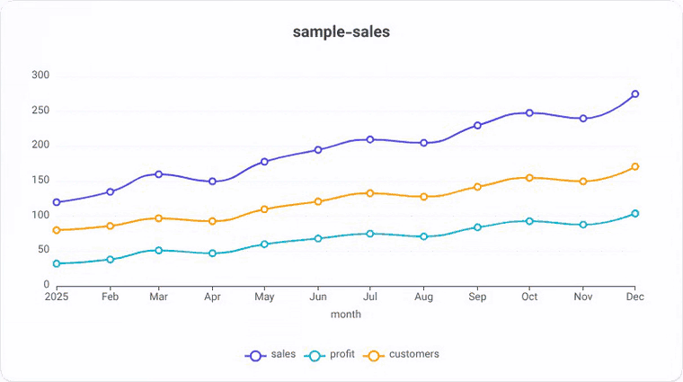
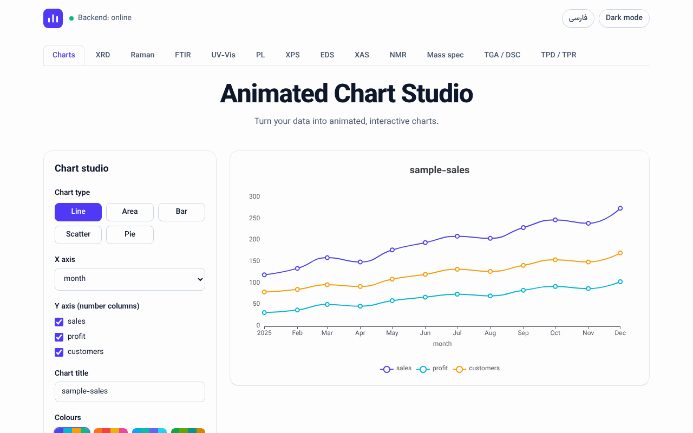
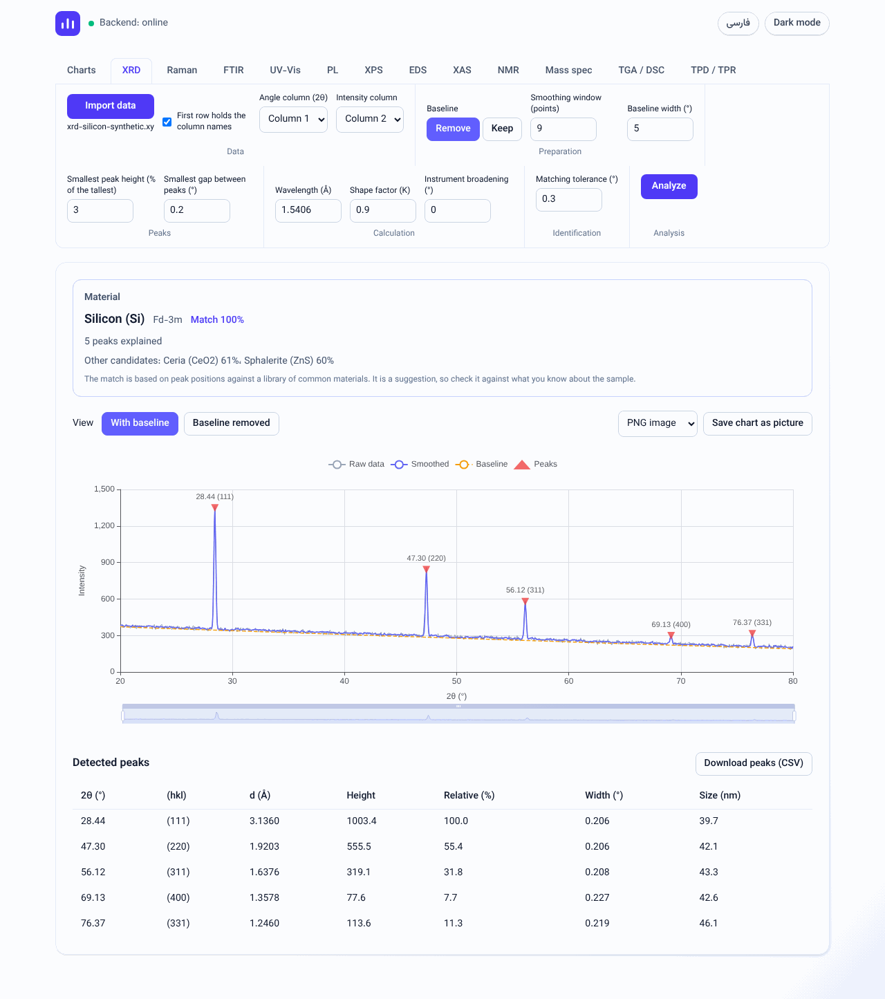
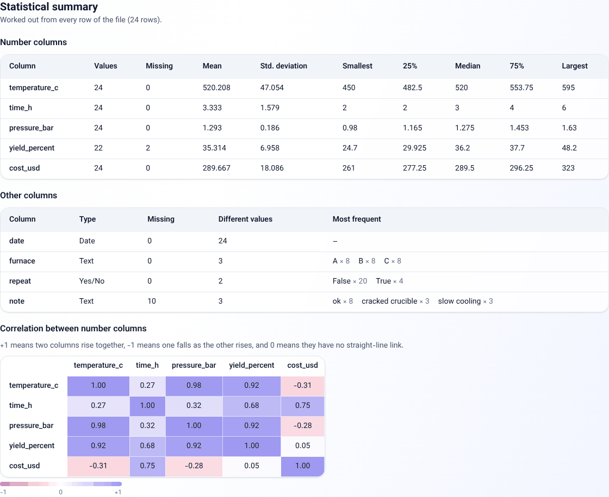
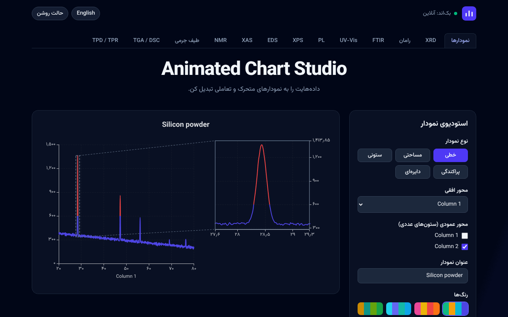

# Animated Chart Studio

A studio for animated, interactive charts, with analysis tools for materials-characterization
data. Load a table or the file an instrument wrote, turn it into an animated chart, read its
statistics, and analyse X-ray diffraction (XRD) patterns down to the name of the material.
The interface is in English and Persian (right to left), with a light and a dark theme.

## Contents

- [Features](#features)
- [Screenshots](#screenshots)
- [Quick start](#quick-start)
- [Using the app](#using-the-app)
- [Files it reads](#files-it-reads)
- [API](#api)
- [Settings](#settings)
- [Project structure](#project-structure)
- [Development](#development)
- [Roadmap](#roadmap)
- [License](#license)

## Features

**Data**

- Reads CSV and Excel files, and the text files instruments write (`.xy`, `.xye`, `.dat`, `.asc`,
  `.txt`, `.tsv`). Notes above the numbers are skipped; tabs, spaces, semicolons and decimal
  commas are understood.
- Shows the data as a table, with the type of each column and its missing values.
- A statistical summary of every file: mean, standard deviation, quartiles and the most frequent
  values of each column, and a correlation table of the number columns.

**Charts**

- Line, area, bar, scatter and pie charts, with colour palettes and an animation you can replay.
- Colour ranges on the X or the Y axis, cropping, a zoom slider and an adjustable chart height.
- A magnifier: a frame on the chart with that part enlarged beside it, with its own animation.
- Export as PNG, JPEG, SVG, or as a WebM video of the animation.

**XRD analysis**

- Import with checks that tell you what is wrong with a file that is not an XRD pattern.
- Smoothing, baseline removal, peak detection, d-spacing (Bragg's law) and crystallite size
  (Scherrer equation).
- Material identification: the peaks are matched against a library of 49 common materials, the
  best match is named and every peak gets its Miller indices (hkl).
- The peak table downloads as CSV, and the chart saves as a PNG, JPEG or SVG picture of the part
  that is on screen.

**Interface**

- English and Persian, light and dark.
- An Excel-style ribbon with a tab for each spectrum type. XRD is built; the others are on the
  [roadmap](#roadmap).

## Screenshots

| Charts | XRD analysis |
| --- | --- |
|  |  |

| Statistical summary | Magnifier and colour range, in Persian with the dark theme |
| --- | --- |
|  |  |

## Quick start

### With Docker

One command builds and starts the whole app:

~~~bash
docker compose up --build
~~~

Then open http://localhost:8080. The API is also on http://localhost:8000, with interactive docs
at http://localhost:8000/docs. Set `FRONTEND_PORT` or `BACKEND_PORT` to use other ports.

### Without Docker

You need [uv](https://docs.astral.sh/uv/) (it installs Python 3.12 by itself) and Node 22. Start
the two parts in two terminals.

Backend, on http://localhost:8000:

~~~bash
cd backend
uv sync
uv run uvicorn chart_studio_api.main:app --reload
~~~

Frontend, on http://localhost:5173 (it passes `/api` on to the backend):

~~~bash
cd frontend
npm ci
npm run dev
~~~

## Using the app

### Charts

1. On the **Charts** tab, drop a file on the upload box, or press **Try sample data**.
   `samples/synthesis-runs.csv` is a small made-up table with dates, text and numbers to try.
2. Pick the chart type, the X column and one or more Y columns. The chart draws itself; **Replay
   animation** plays it again.
3. Colour ranges, cropping, the zoom slider and the magnifier are in the panel beside the chart.
4. Under the chart are the statistical summary and the data itself.
5. Choose a format and press **Export** to save the chart.

### XRD analysis

1. Open the **XRD** tab and press **Import data**. Pick `samples/xrd-silicon-synthetic.xy`, a
   synthetic silicon pattern as an instrument would write it (the same pattern is there as
   `.csv`).
2. The angle and intensity columns are found automatically and the data is checked. If it looks
   like an XRD pattern, the analysis runs at once.
3. The chart shows the raw, smoothed and baseline curves with the peaks marked. The table lists
   each peak with its position, Miller indices, d-spacing, height, width and crystallite size, and
   the material card names the best match from the library.
4. Change a setting in the ribbon (wavelength, smoothing, baseline, peak height, tolerance) and
   press **Analyze** to run it again.

The match is a suggestion based on peak positions, so check it against what you know about the
sample.

## Files it reads

| File | What is expected |
| --- | --- |
| `.csv` | A table with a header row. The separator (comma, semicolon, tab) is worked out. A file with two or more lines of notes above its numbers is read as an instrument file. |
| `.xlsx` | The first sheet, with a header row. |
| `.xy`, `.xye`, `.dat`, `.asc`, `.txt`, `.tsv` | Columns of numbers, with or without notes above them and with or without a row of column names. A text table with words in it is read as a table. |

Limits: 10 MB per file and 50 000 rows; a text or CSV file can have up to 2 000 columns. The
header row can be switched off after loading. Vendor formats that are not plain columns of
numbers (`.xrdml`, `.raw`, `.brml`) are not read yet.

## API

The backend is a small REST API. Its interactive documentation is at `/docs`.

| Method and path | What it does |
| --- | --- |
| `GET /health` | Says that the service is up, and its version. |
| `POST /api/v1/datasets/parse` | Reads an uploaded file (form field `file`, optional `header=false`) and returns its columns, rows and statistical summary. |
| `POST /api/v1/analysis/summary` | Returns the same summary for rows sent as JSON (up to 100 000 rows). |
| `POST /api/v1/xrd/analyze` | Smooths a pattern, removes its baseline and returns the curves and the peaks. |
| `POST /api/v1/xrd/identify` | Matches peaks against the reference library and returns the materials and the Miller indices. |

For example:

~~~bash
curl -F file=@samples/xrd-silicon-synthetic.xy http://localhost:8000/api/v1/datasets/parse
~~~

More about the analysis and the reference library is in [backend/README.md](backend/README.md).

## Settings

The backend reads these environment variables (or a `.env` file in `backend/`):

| Variable | Default | Meaning |
| --- | --- | --- |
| `CHART_STUDIO_MAX_UPLOAD_BYTES` | `10485760` | Largest file that is accepted, in bytes. |
| `CHART_STUDIO_MAX_ROWS` | `50000` | Largest table that is accepted, in rows. |
| `CHART_STUDIO_DEBUG` | `false` | FastAPI debug mode. |

Docker Compose reads `FRONTEND_PORT` (default `8080`) and `BACKEND_PORT` (default `8000`). In
Docker, nginx stops uploads over 12 MB before they reach the backend; raise `client_max_body_size`
in `frontend/nginx.conf` together with `CHART_STUDIO_MAX_UPLOAD_BYTES`.

## Project structure

~~~text
backend/    FastAPI service: file reading, summaries and XRD analysis
frontend/   React app: chart studio, summary panel and XRD workspace; served by nginx in Docker
samples/    Example data files
docs/       Pictures for this page
.github/    Workflows, issue and pull request templates, Dependabot
~~~

| Part | Tools |
| --- | --- |
| Backend | Python 3.12, FastAPI, pandas, NumPy, SciPy, pybaselines, uv |
| Frontend | React, TypeScript, Vite, Tailwind CSS, Apache ECharts, Zustand, i18next |
| Quality | pytest, ruff, mypy (strict), Vitest, oxlint, CodeQL, Dependabot |

## Development

~~~bash
# backend
cd backend && uv run ruff check . && uv run ruff format --check . && uv run mypy && uv run pytest

# frontend
cd frontend && npm run lint && npm run build && npm test
~~~

Every pull request runs these checks, builds both Docker images and tries the running app, and
runs CodeQL and a dependency review. Pull request titles follow
[Conventional Commits](https://www.conventionalcommits.org/) (`feat:`, `fix:`, `docs:` ...), because
the squashed title becomes the commit message on `main`. See [CONTRIBUTING.md](CONTRIBUTING.md),
[backend/README.md](backend/README.md) and [frontend/README.md](frontend/README.md).

## Roadmap

The planned spectrum tools are tracked as issues in the
[Spectra analysis tools](https://github.com/h-shayeg/animated-chart-studio/milestones) milestone:
Raman, FTIR, UV-Vis, photoluminescence, XPS, EDS, XAS, NMR, mass spectra, TGA and DSC, and
TPD and TPR.

Questions and ideas are welcome in
[Discussions](https://github.com/h-shayeg/animated-chart-studio/discussions). Security problems
should be reported privately, see [SECURITY.md](SECURITY.md).

## License

[MIT](LICENSE)
